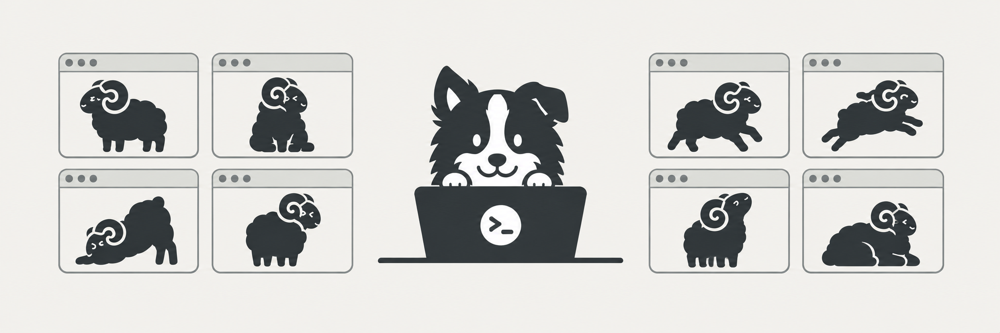

<picture>
  <source media="(prefers-color-scheme: dark)" srcset="assets/banner-dark.png">
  <source media="(prefers-color-scheme: light)" srcset="assets/banner-light.png">
  
</picture>

# herdr-pstack-orchestrator

[](https://github.com/conscientiousness/herdr-pstack-orchestrator/actions/workflows/validate.yml)
[](https://github.com/conscientiousness/herdr-pstack-orchestrator/actions/workflows/upstream.yml)
[](https://github.com/cursor/plugins/tree/c742dd61706fbacc1b95f1a20b7b988cf096ce6c/pstack)
[](LICENSE)

Give your coding agent a team of workers in [Herdr](https://herdr.dev). Ask one
agent to coordinate a task; it can delegate investigation or implementation to
Pi, Codex CLI, or Claude Code workers, collect their results, and check the work.
Installed herdr-core runs workers in persistent terminals, including headless
sessions. Controllers running in Herdr must show workers in `hcOrch` viewer
tabs in the same verified workspace, keeping focus and the controller tab unchanged.
Only core's absence selects the original Herdr runtime, whose worker tabs stay `horch`.

Use the core skill for delegation, or add the optional **pstack** bundle for
workflows such as independent review and multi-step implementation. You can use
one configured worker or several, including workers from different harnesses.
No changes to your application code are needed.

[Latest release](https://github.com/conscientiousness/herdr-pstack-orchestrator/releases/latest).

<picture>
  <source media="(prefers-color-scheme: dark)" srcset="assets/workflow-dark.svg">
  <source media="(prefers-color-scheme: light)" srcset="assets/workflow-light.svg">
  
</picture>

## Requirements

- [herdr-core](https://github.com/herdrdev/herdr-core), with agent CLIs that report
  native OSC 7501 status. Core 0.1.17 has Linux E2E coverage. If core is absent,
  [Herdr](https://herdr.dev) 0.9.3 or later supplies the legacy fallback, with your
  controller in a Herdr pane (`HERDR_ENV=1`). An unhealthy installed core does not
  fall back.
- Python 3.11 or later with POSIX file locks. Linux has been tested; macOS is not yet verified.
- Node.js 22.20 or later and npm for the installer.
- The agent CLIs you want to use—`pi`, `codex`, or `claude`—installed and authenticated.
- For legacy Pi workers only, install Herdr's integration with `herdr integration install pi`. Core uses native status and needs no custom hooks or extensions.

## Install

Run one of these commands from your project. `skills@latest` uses the latest
[Skills CLI](https://github.com/vercel-labs/skills) from npm. For delegation
alone, install the core skill:

```bash
npx skills@latest add conscientiousness/herdr-pstack-orchestrator -s herdr-orchestrator
```

For pstack workflows as well, install the full bundle:

```bash
npx skills@latest add https://github.com/conscientiousness/herdr-pstack-orchestrator/tree/main/skills --skill '*'
```

Choose your agent harnesses and project or global scope in the installer, and
review any same-name skill conflicts. Then start a **new agent session** so it
can load the skills. Core can run headless; legacy execution requires Herdr. See the [installation guide](docs/INSTALL.md)
for manual installation, updates, and removal.

## Quickstart

In your new controller session, ask your agent to set up its workers:

```text
Set up the herdr-orchestrator skill with me. Find the available harnesses,
ask me which workers, models, and permissions to use, then check the setup.
```

After setup, give it a task. For example:

```text
Use herdr-orchestrator to fix the login redirect bug in this repository.
Delegate the implementation and have a fresh worker review the result before
reporting back.
```

The controller creates a separate process for each task, waits for the result,
and checks the work. You can inspect the worker panes as it goes.

## Configuration

Your agent helps you create `~/.config/herdr-orchestrator/workers.toml` (or the
equivalent under `$XDG_CONFIG_HOME`). It records each worker's harness, model,
and permission settings; new tasks use the current definitions. One worker is
enough to start, and you can add more later.

Workers run with the permissions you choose. `horch` does not enforce a sandbox,
and separate worktrees only keep edits apart. See [setup and configuration](skills/herdr-orchestrator/references/setup.md)
for the available options and permission behavior.

## Optional: original pstack through Herdr

The full bundle includes selected original [pstack](https://github.com/cursor/plugins/tree/c742dd61706fbacc1b95f1a20b7b988cf096ce6c/pstack)
skills and a Herdr adapter. After installing it and configuring workers, try:

```text
Use interrogate to review this branch.
```

Or ask for `poteto-mode` when you want a broader workflow. The controller can
help configure the worker roles that a workflow needs. For the included skills,
role mapping, and compatibility details, see the [pstack guide](skills/pstack-herdr/references/compatibility.md).

Some original workflows require tools this adapter does not provide, including
Cursor hooks or cloud execution. A workflow cannot complete a required step when
its tools are unavailable. Full pstack playbook coverage has not been verified;
see the [playbook inventory](e2e/PLAYBOOKS.md) for current results.

## Update

To update, rerun the [install command](#install) you chose, select the same
harnesses and scope, and start a new controller session. These commands install from
this repository's `main` branch. The [installation guide](docs/INSTALL.md) also
explains how to update a manual clone or remove the skills.

## Troubleshooting

Ask your agent to run `horch detect` to check available harnesses and Pi
integration. Tasks keep their launch backend. Core tasks also pin the endpoint,
so later installation or environment changes do not reroute their cleanup. If a worker stops or fails, inspect its
recorded backend terminal before closing it. The [setup guide](skills/herdr-orchestrator/references/setup.md) and [task
recovery guide](skills/herdr-orchestrator/references/lifecycle.md#problem-recovery)
cover common problems.

## More information

- [Worker commands and lifecycle](skills/herdr-orchestrator/SKILL.md)
- [Verification evidence](docs/RELEASE-EVIDENCE.md) and [known gaps](docs/CAPABILITY-GAPS.md)
- [Contributing](CONTRIBUTING.md)

Built for [Herdr](https://herdr.dev), with an independent adapter for Lauren
Tan's [pstack](https://github.com/cursor/plugins/tree/main/pstack). The banner
and workflow diagram have their own [asset notes](assets/banner-prompt.md) and
[diagram notices](assets/workflow.md). Licensed under the [MIT License](LICENSE).
