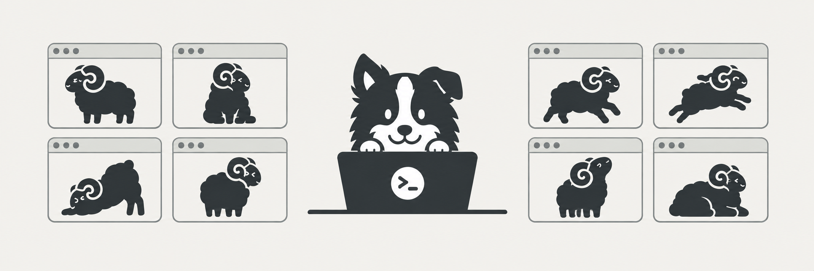

<picture>
  <source media="(prefers-color-scheme: dark)" srcset="assets/banner-dark.png">
  <source media="(prefers-color-scheme: light)" srcset="assets/banner-light.png">
  
</picture>

# herdr-pstack-orchestrator

[](https://github.com/conscientiousness/herdr-pstack-orchestrator/actions/workflows/validate.yml)
[](https://github.com/conscientiousness/herdr-pstack-orchestrator/actions/workflows/upstream.yml)
[](https://github.com/cursor/plugins/tree/c742dd61706fbacc1b95f1a20b7b988cf096ce6c/pstack)
[](LICENSE)

Give your coding agent a team of workers in [Herdr](https://herdr.dev). Ask one
agent to coordinate a task; it can delegate investigation or implementation to
Pi, Codex CLI, or Claude Code workers, collect their results, and check the work.
Workers open in their own Herdr panes, while your controller stays in its
original tab.

Use the core skill for delegation, or add the optional **pstack** bundle for
workflows such as independent review and multi-step implementation. You can use
one configured worker or several, including workers from different harnesses.
No changes to your application code are needed.

[Latest release](https://github.com/conscientiousness/herdr-pstack-orchestrator/releases/latest).

<picture>
  <source media="(prefers-color-scheme: dark)" srcset="assets/workflow-dark.svg">
  <source media="(prefers-color-scheme: light)" srcset="assets/workflow-light.svg">
  
</picture>

## Requirements

- [Herdr](https://herdr.dev) 0.9.3 or later, with your controller agent running in a Herdr pane (`HERDR_ENV=1`).
- Python 3.11 or later with POSIX file locks. Linux has been tested; macOS is not yet verified.
- Node.js and npm for the installer.
- The agent CLIs you want to use—`pi`, `codex`, or `claude`—installed and authenticated.
- For Pi workers, install Herdr's integration: `herdr integration install pi`.

## Install

Run one of these commands from your project. For delegation alone, install the
core skill:

```bash
npx skills@1.7.1 add conscientiousness/herdr-pstack-orchestrator -s herdr-orchestrator
```

For pstack workflows as well, install the full bundle:

```bash
npx skills@1.7.1 add https://github.com/conscientiousness/herdr-pstack-orchestrator/tree/main/skills --skill '*'
```

Choose your agent harnesses and project or global scope in the installer, and
review any same-name skill conflicts. Then start a **new agent session inside
Herdr** so it can load the skills. See the [installation guide](docs/INSTALL.md)
for manual installation, updates, and removal.

## Quickstart

In your new Herdr session, ask your agent to set up its workers:

```text
Set up the herdr-orchestrator skill with me. Find the available harnesses,
ask me which workers, models, and permissions to use, then check the setup.
```

After setup, give it a task. For example:

```text
Use herdr-orchestrator to fix the login redirect bug in this repository.
Delegate the implementation and have a fresh worker review the result before
reporting back.
```

The controller creates a separate process for each task, waits for the result,
and checks the work. You can inspect the worker panes as it goes.

## Configuration

Your agent helps you create `~/.config/herdr-orchestrator/workers.toml` (or the
equivalent under `$XDG_CONFIG_HOME`). It records each worker's harness, model,
and permission settings; new tasks use the current definitions. One worker is
enough to start, and you can add more later.

Workers run with the permissions you choose. `horch` does not enforce a sandbox,
and separate worktrees only keep edits apart. See [setup and configuration](skills/herdr-orchestrator/references/setup.md)
for the available options and permission behavior.

## Optional: original pstack through Herdr

The full bundle includes selected original [pstack](https://github.com/cursor/plugins/tree/c742dd61706fbacc1b95f1a20b7b988cf096ce6c/pstack)
skills and a Herdr adapter. After installing it and configuring workers, try:

```text
Use interrogate to review this branch.
```

Or ask for `poteto-mode` when you want a broader workflow. The controller can
help configure the worker roles that a workflow needs. For the included skills,
role mapping, and compatibility details, see the [pstack guide](skills/pstack-herdr/references/compatibility.md).

Some original workflows require tools this adapter does not provide, including
Cursor hooks or cloud execution. A workflow cannot complete a required step when
its tools are unavailable. Full pstack playbook coverage has not been verified;
see the [playbook inventory](e2e/PLAYBOOKS.md) for current results.

## Update

To update, rerun the [install command](#install) you chose, select the same
harnesses and scope, and start a new Herdr session. These commands install from
this repository's `main` branch. The [installation guide](docs/INSTALL.md) also
explains how to update a manual clone or remove the skills.

## Troubleshooting

Ask your agent to run `horch detect` to check available harnesses and Pi
integration. If a worker stops or fails, inspect its Herdr pane before closing
it. The [setup guide](skills/herdr-orchestrator/references/setup.md) and [task
recovery guide](skills/herdr-orchestrator/references/lifecycle.md#problem-recovery)
cover common problems.

## More information

- [Worker commands and lifecycle](skills/herdr-orchestrator/SKILL.md)
- [Verification evidence](docs/RELEASE-EVIDENCE.md) and [known gaps](docs/CAPABILITY-GAPS.md)
- [Contributing](CONTRIBUTING.md)

Built for [Herdr](https://herdr.dev), with an independent adapter for Lauren
Tan's [pstack](https://github.com/cursor/plugins/tree/main/pstack). The banner
and workflow diagram have their own [asset notes](assets/banner-prompt.md) and
[diagram notices](assets/workflow.md). Licensed under the [MIT License](LICENSE).
