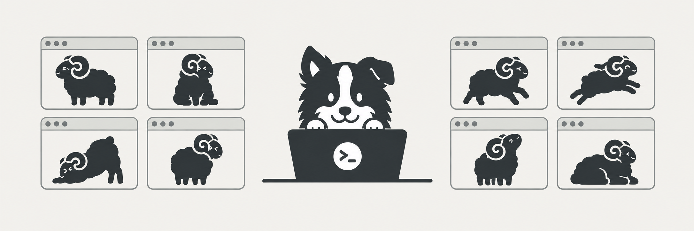

<picture>
  <source media="(prefers-color-scheme: dark)" srcset="assets/banner-dark.png">
  <source media="(prefers-color-scheme: light)" srcset="assets/banner-light.png">
  
</picture>

# herdr-rex-pstack-orchestrator

[](LICENSE)

Give your coding agent a team of workers in [Herdr](https://herdr.dev) or
[Rex](https://www.superlogical.com/rex/docs/automate/cli). One agent coordinates
the task, delegates investigation or implementation to Pi, Codex CLI, or Claude
Code workers, and verifies their results.

Follow tasks in the **Workers** tab while your controller stays in focus. Add
the optional **pstack** bundle for workflows such as independent review and
multi-step implementation.

[Latest release](https://github.com/conscientiousness/herdr-rex-pstack-orchestrator/releases/latest).

<picture>
  <source media="(prefers-color-scheme: dark)" srcset="assets/workflow-dark.svg">
  <source media="(prefers-color-scheme: light)" srcset="assets/workflow-light.svg">
  
</picture>

## Requirements

- Python 3.11 or later.
- Node.js 22.20 or later and npm for the installer.
- Install and sign in to each agent CLI you want to use (`pi`, `codex`, or `claude`).
- For Rex, run a local Unix-socket Rex server and install the `rex` CLI.
- For Herdr, use [herdr-core](https://github.com/herdrdev/herdr-core) or Herdr
  0.9.3 or later. For Pi on Herdr without core, run `herdr integration install pi`.
  To run workers headless, install herdr-core.
- With Rex or herdr-core, use agent CLI versions that
  [report worker status](skills/agent-workers/references/setup.md).

## Install

Run this from your project to install the core skill:

```bash
npx skills@latest add conscientiousness/herdr-rex-pstack-orchestrator -s agent-workers
```

For pstack workflows as well, install the full bundle:

```bash
npx skills@latest add https://github.com/conscientiousness/herdr-rex-pstack-orchestrator/tree/main/skills --skill '*'
```

Choose your agent harnesses and project or global scope in the installer, and
review any same-name skill conflicts. Then start a **new agent session** so it
can load the skills. See the [installation guide](docs/INSTALL.md) for manual
installation, updates, and removal.

## Quickstart

Start a new agent session in Herdr or Rex, or from a shell with herdr-core for
headless use. Ask your agent to set up its workers:

```text
Set up the agent-workers skill with me. Find the available harnesses,
ask me which workers, models, and permissions to use, then check the setup.
```

After setup, give it a task. For example:

```text
Use agent-workers to fix the login redirect bug in this repository.
Delegate the implementation and have a fresh worker review the result before
reporting back.
```

## Configuration

Your agent helps you create `~/.config/herdr-orchestrator/workers.toml` (or the
equivalent under `$XDG_CONFIG_HOME`). Start with one worker and choose its agent
CLI, model, and permissions. Edit the file before starting new tasks to change
those settings. See [setup and configuration](skills/agent-workers/references/setup.md).

## Optional pstack workflows

The full bundle includes selected original [pstack](https://github.com/cursor/plugins/tree/2f87c854fe3e2fcda44ca86b46ede35aad3c46b7/pstack)
skills and an adapter that delegates through `agent-workers`. After installing
the bundle and configuring workers, try:

```text
Use interrogate to review this branch.
```

Or ask for `poteto-mode` when you want a broader workflow. The controller can
help configure the worker roles that a workflow needs. For the included skills,
role mapping, and compatibility details, see the [pstack guide](skills/pstack-herdr/references/compatibility.md).

## Update

If you installed `herdr-orchestrator`, follow the [rename upgrade guide](docs/INSTALL.md#upgrade-from-herdr-orchestrator).
To update, rerun your [install command](#install), select the same harnesses and
scope, and start a new agent session.

## Troubleshooting

If setup fails, ask your agent to run `agent-workers detect` to check the
selected backend, available agent CLIs, and Pi integration status. If a worker
stops or fails, inspect its terminal before closing it. See the
[task recovery guide](skills/agent-workers/references/lifecycle.md#problem-recovery).

## More information

- [Worker commands and lifecycle](skills/agent-workers/SKILL.md)
- [Contributing](CONTRIBUTING.md)

Includes an independent adapter for Lauren Tan's
[pstack](https://github.com/cursor/plugins/tree/main/pstack).
